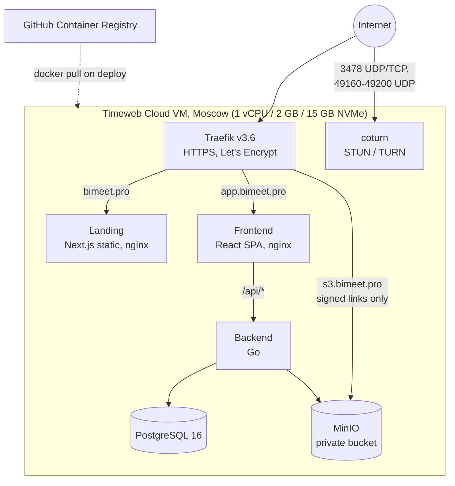
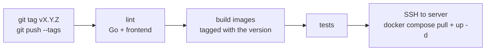

# Bimeet

Bimeet is an event planning service for the Russian market. Organizers create events, invite participants, and manage money collections, polls, item lists, carpools, chat and one-on-one calls in one place.

| Application | Role | Address |
|---|---|---|
| **Backend** | Go REST API | internal, served under `app.bimeet.pro/api` |
| **Frontend** | React SPA | `app.bimeet.pro` |
| **Landing** | Marketing site | `bimeet.pro`, `www.bimeet.pro` |

Production runs on **Timeweb Cloud (Moscow)**, so personal data of Russian users stays in Russia (Federal Law 152-FZ / 242-FZ). The infrastructure is defined in Terraform and does not depend on provider-specific services.

---

## Production architecture



All services run in one Docker Compose file (`docker-compose.prod.yml`). An optional `observability` profile adds Jaeger, Loki, Promtail and Grafana; their UIs are bound to `127.0.0.1` and reached through an SSH tunnel.

Key points:

- **Files are private.** The database stores only object keys. `GET /api/files/{key}` redirects to a presigned MinIO link that expires after 5 minutes; direct bucket access returns 403.
- **1:1 calls are peer to peer** (WebRTC). Signalling goes through the backend (POST + Server-Sent Events). Our own coturn provides STUN and TURN with short-lived credentials issued by the backend, so calls do not depend on Google's STUN servers.
- **Client IP is trusted only from our own proxies.** The rate limiter (10 req/min on `/api/auth/*`, 300 req/min on the API) cannot be bypassed with forged `True-Client-IP` / `X-Real-IP` headers.

Details and diagrams: [docs/architecture.md](docs/architecture.md).

---

## Infrastructure as code

Terraform in [`infra/terraform`](infra/terraform/README.md) creates the Timeweb project, SSH key, floating IP, the server (custom 1 vCPU / 2 GB / 15 GB) and the cloud firewall. Cloud-init installs Docker and `ufw` on first boot. The server is protected with `prevent_destroy`, because its disk holds the database and uploaded files.

Every pull request that touches Terraform runs `terraform fmt -check` and `terraform validate` ([`infra.yml`](.github/workflows/infra.yml)).

---

## Deployment



- Deployment is triggered **only by a Git tag** ([`deploy.yml`](.github/workflows/deploy.yml)), not by pushes to `master`.
- Every image is tagged with the release version, so production runs exactly the images that passed the checks.
- **Rollback:** deploy the previous tag.
- The MinIO images are loaded onto the server manually, because the upstream registry returns 403 to Russian IP addresses; see [docs/deploy.md](docs/deploy.md).

Environment variables, GitHub secrets and manual deploy steps: [docs/deploy.md](docs/deploy.md), template in [`.env.prod.example`](.env.prod.example).

---

## Applications

### Backend

Go 1.26, three layers: **handler → service → repository → PostgreSQL**.

Main features:

- Passwordless login with an e-mail code, JWT access tokens with refresh, session list and revocation
- Events: create, edit, schedule, complete, invite links, public events
- Participants, money collections with payment confirmation, polls, item lists, carpools
- Event chat with images, reactions and unread counters; live updates over Server-Sent Events
- 1:1 call signalling and ICE server credentials
- Notifications and Web Push
- Admin statistics

Main dependencies: `go-chi/chi`, `go-chi/httprate`, `jackc/pgx`, `golang-jwt/jwt`, `aws-sdk-go-v2` (S3 / MinIO), `webpush-go`, OpenTelemetry, `swaggo` (Swagger at `/swagger/`).

Migrations run automatically at startup from embedded `*.up.sql` files.

API reference: [docs/swagger.md](docs/swagger.md) and `/swagger/` on a running backend.

### Frontend

React 19 + TypeScript + Vite, **Feature-Sliced Design** (`app / pages / widgets / features / entities / shared`). Nginx serves the static build, proxies `/api/` to the backend and clears client-supplied IP headers.

### Landing

Next.js static export served by nginx.

---

## Testing and quality

- `make test`: backend unit tests (including client IP and rate-limit bypass tests)
- `make lint`: golangci-lint; `npm run lint` for the frontend
- **Load test:** k6 against production, 10 → 100 virtual users. At 100 users: ~69 req/s, p95 ≈ 150 ms, 0 errors, backend CPU ≈ 11 %. Script, method and limitations: [loadtest/README.md](loadtest/README.md)
- **Monitoring:** external uptime check (UptimeRobot, every 5 minutes) for `app.bimeet.pro` and `bimeet.pro` with e-mail alerts

---

## Decisions and runbooks

Architecture Decision Records ([docs/adr](docs/adr)):

| ADR | Decision |
|---|---|
| [0001](docs/adr/0001-hosting-provider.md) | Hosting provider: Timeweb Cloud |
| [0002](docs/adr/0002-file-storage-private-presigned.md) | Private files: keys in the database, presigned redirect |
| [0003](docs/adr/0003-minio-on-server.md) | MinIO on the same VM |
| [0004](docs/adr/0004-ci-cd-and-registry.md) | CI/CD: GitHub Actions + GHCR, tag-triggered deploy |
| [0005](docs/adr/0005-calls-p2p-webrtc.md) | 1:1 calls: P2P WebRTC with our own coturn |

Runbooks: [first launch on Timeweb](docs/runbooks/timeweb-launch.md), [backup and restore](docs/runbooks/backup-restore.md), [checking calls after a deploy](docs/runbooks/calls-check.md).

---

## Known limitations

- Single server; backups are stored on the same server (moving them to another provider is the next step).
- No staging environment.
- Monitoring is limited to an external uptime check; metrics and log-based alerts are planned.
- The e-mail provider is not connected yet; the demo uses a test login mode.
- `/api/files` does not yet check meeting membership.
- Group calls need a media server (e.g. LiveKit) and are not implemented.

---

## Local development

Requirements: Docker + Docker Compose, Make.

```bash
make dev   # foreground, all logs
make up    # detached
```

The stack starts PostgreSQL, MailHog, MinIO, the Go backend with live reload, the Vite frontend with HMR and the Next.js landing.

```bash
make logs SERVICE=backend
make ps
make restart
make down
make db-shell
make test
make lint
```

| Service | URL |
|---|---|
| Landing | http://localhost:3000 |
| Frontend | http://localhost:5173 |
| Backend API | http://localhost:8080 |
| MinIO console | http://localhost:9001 |
| MailHog | http://localhost:8025 |

Local `.env` files are optional; if present, `backend/.env` and `frontend/.env` are loaded.
