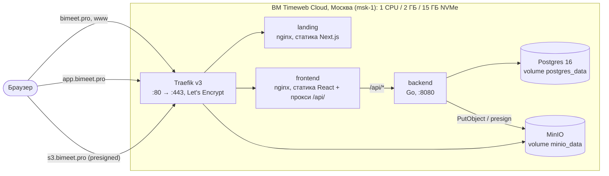
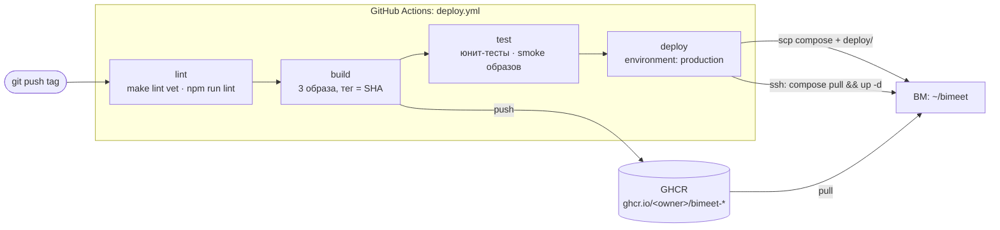
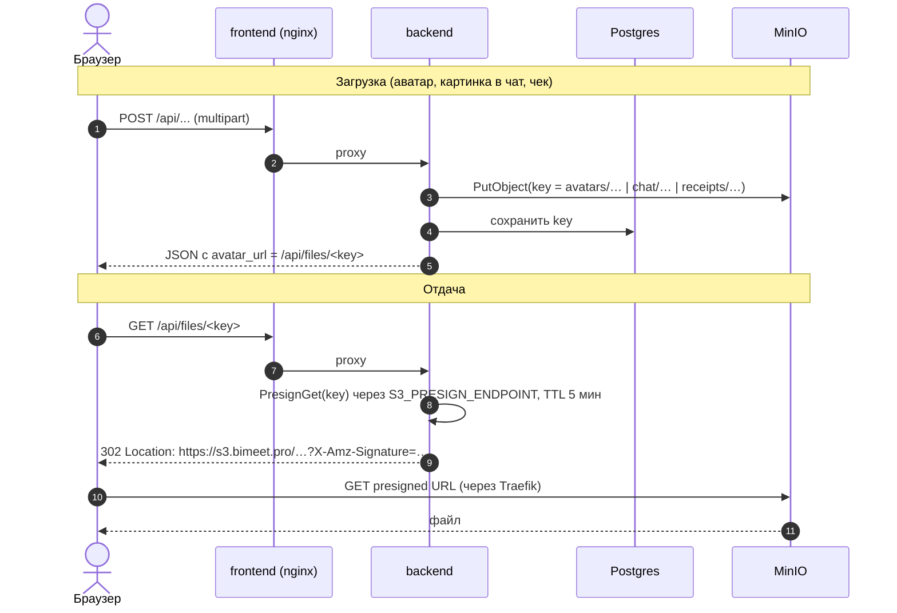
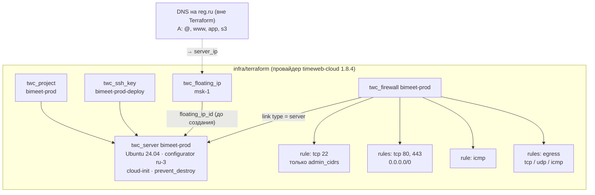

# Архитектура Bimeet (прод)

Решения, на которых держится схема: [ADR](adr/). Запуск: [runbooks/timeweb-launch.md](runbooks/timeweb-launch.md).

## 1. Контейнеры на сервере

Все сервисы — один `docker-compose.prod.yml` в общей сети `app-net` на одной ВМ; наружу открыты только порты 80 и 443 у Traefik, он же выпускает сертификаты Let's Encrypt. Backend не публикуется напрямую: браузер ходит на `app.bimeet.pro`, а nginx фронтенда проксирует `/api/*` в `backend:8080`. Данные (Postgres и файлы MinIO) лежат в Docker-томах на диске этой же ВМ, поэтому бэкап вне сервера — открытый вопрос ([ADR 0003](adr/0003-minio-on-server.md)).

## 2. Деплой

Пайплайн запускается только на push тега и проходит четыре джоба последовательно. Образы попадают в GHCR на шаге `build`, но на сервер уходят только после зелёных тестов и smoke-проверки, причём именно с тегом проверенного коммита. Деплой — это `scp` compose-файла и `docker compose pull && up -d` по SSH под пользователем `deploy`, см. [ADR 0004](adr/0004-ci-cd-and-registry.md).

## 3. Загрузка и отдача файла

В БД хранится только ключ объекта, а наружу отдаётся стабильный путь `/api/files/<key>`, поэтому фронтенд и старые ссылки не зависят от хранилища и домена. На каждый запрос backend выпускает новую подписанную ссылку на несколько минут и подписывает её публичным адресом `s3.bimeet.pro`, а не внутренним `minio:9000`. Подробности и найденные баги — [ADR 0002](adr/0002-file-storage-private-presigned.md).

## 4. Инфраструктура в Terraform

Terraform создаёт 12 ресурсов: проект, SSH-ключ, floating IP, сервер и облачный файрвол с семью правилами. IP создаётся раньше сервера и передаётся через `floating_ip_id`, потому что cloud-init при первой загрузке ставит Docker и ему сразу нужен интернет. DNS остаётся у регистратора (reg.ru), четыре A-записи ставятся вручную на `server_ip` из `terraform output`.
