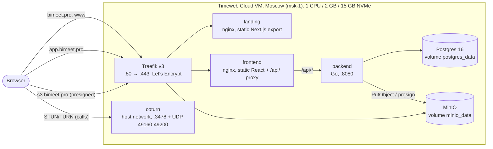
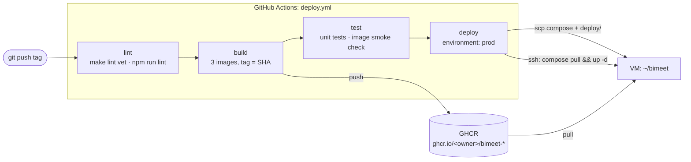
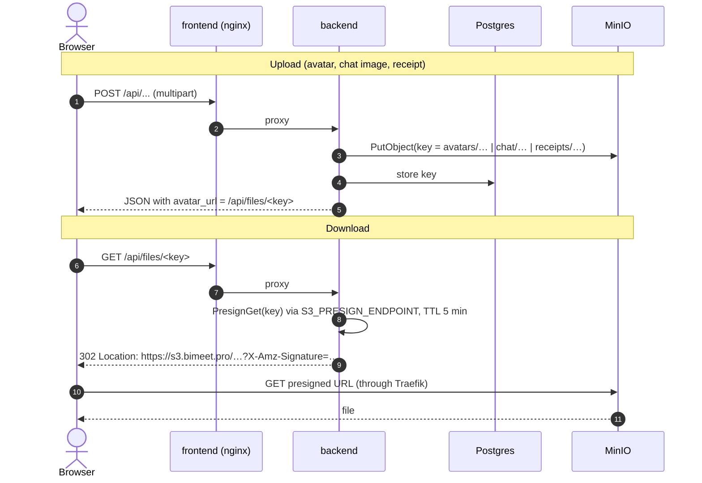
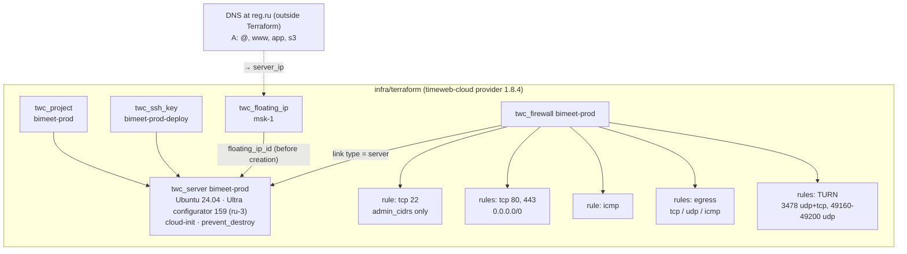
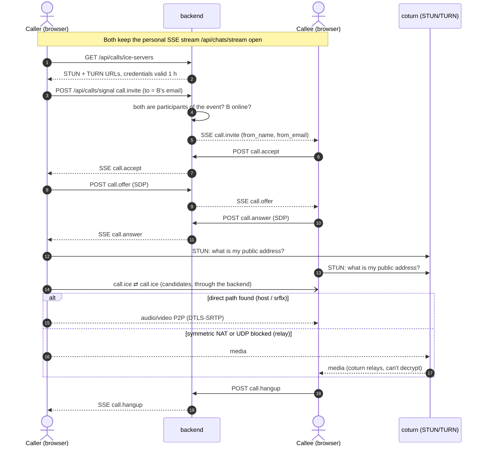

# Bimeet architecture (production)

Decisions behind this picture: [ADR](adr/). First launch: [runbooks/timeweb-launch.md](runbooks/timeweb-launch.md).

## 1. Containers on the server

Every service is part of one `docker-compose.prod.yml` on a shared `app-net` network on a single VM; only Traefik's ports 80 and 443 are exposed, plus coturn's STUN/TURN ports for calls (coturn runs on the host network), and Traefik also obtains the Let's Encrypt certificates. The backend is not published directly: the browser talks to `app.bimeet.pro`, and the frontend's nginx proxies `/api/*` to `backend:8080`. Data (Postgres and MinIO files) lives in Docker volumes on the same VM's disk, which is why an off-server backup is still an open question ([ADR 0003](adr/0003-minio-on-server.md)).

## 2. Deployment

The pipeline runs only on a tag push and goes through four jobs in order. Images reach GHCR in the `build` job, but they go to the server only after the tests and the smoke check pass, and always with the tag of the tested commit. Deployment is an `scp` of the compose file plus `docker compose pull && up -d` over SSH as the `deploy` user; see [ADR 0004](adr/0004-ci-cd-and-registry.md).

## 3. File upload and download

The database stores only the object key, and clients get a stable path `/api/files/<key>`, so the frontend and old links don't depend on the storage or the domain. On every request the backend issues a new signed link valid for a few minutes, signed with the public address `s3.bimeet.pro` rather than the internal `minio:9000`. Details and the bugs found along the way: [ADR 0002](adr/0002-file-storage-private-presigned.md).

## 4. Infrastructure in Terraform

Terraform creates 15 resources: a project, an SSH key, a floating IP, the server, and a cloud firewall with ten rules (three of them for coturn, see section 5). The IP is created before the server and passed in through `floating_ip_id`, because cloud-init installs Docker on first boot and needs internet access right away. DNS stays with the registrar (reg.ru); four A records are set by hand to `server_ip` from `terraform output`.

## 5. A 1:1 call

The backend never sees media and keeps no call state: it checks that both people are participants of the same event and forwards the message into the other person's personal SSE stream. If the callee has no open stream, the caller gets `call.unavailable`; no answer within 30 s ends the call with `call.cancel`. The decision and its trade-offs: [ADR 0005](adr/0005-calls-p2p-webrtc.md). Checking it after a deploy: [runbooks/calls-check.md](runbooks/calls-check.md).
