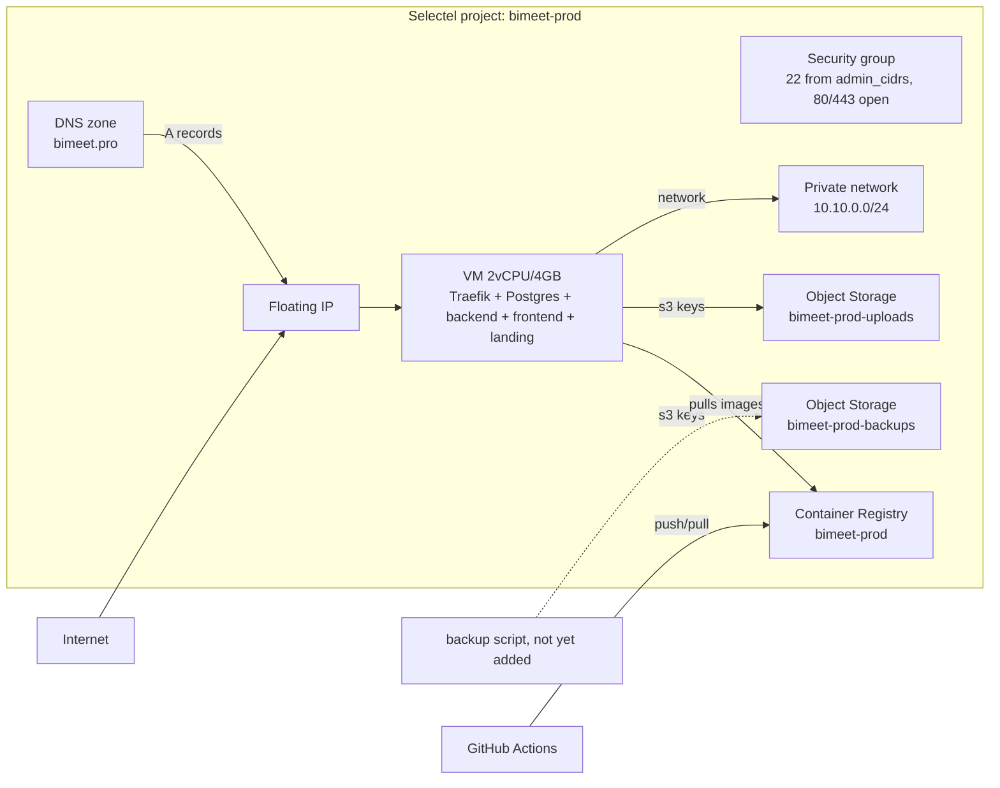

# Bimeet — Terraform / Selectel

Prod infrastructure for Bimeet on Selectel (Russian cloud provider, all resources
in the `ru-9` pool, Moscow region). Replaces the current single-VM
docker-compose deploy (MinIO + GHCR) with: a dedicated Selectel project, a
hardened VM, Selectel Object Storage, Selectel Container Registry (CRaaS),
and Selectel DNS.

## What gets deployed



Everything lives in one AZ on one VM, same as today — this only replaces
the storage/registry/DNS pieces with Selectel-native ones and wraps the
existing VM in Terraform so it's reproducible and declared, not hand-built.

## Prerequisites

1. A Selectel account and a bootstrap service user with the account-scoped
   `member` + `iam.admin` roles (IAM → Service Users in the control panel).
   This user's name/password go into `selectel_username` / `selectel_password`
   — Terraform uses it only once, to create the project and the other
   service users, never for day-to-day operations.
2. A state bucket, created by hand **before the first `terraform init`**:
   - Create an Object Storage container named e.g. `bimeet-prod-tfstate` in
     the Selectel control panel (S3 → Containers), in the `ru-9` pool.
   - Generate S3 credentials for a user with access to it.
   - This bucket is intentionally not managed by this configuration —
     Terraform can't create the bucket it's about to store its own state in.
   - **Lock this bucket down.** `sensitive = true` on an output only hides a
     value from CLI/CI output — Terraform still writes every value (S3
     keys, service user passwords, the CI password) into the state file in
     plaintext. The state bucket's own access control is the only thing
     actually protecting those secrets, so give it as few readers as the
     bootstrap/admin credentials themselves.
3. Terraform >= 1.10 (for `use_lockfile`, no DynamoDB-style lock table
   needed). `terraform version` to check.

## Usage

```bash
cd infra/terraform
cp terraform.tfvars.example terraform.tfvars   # fill in real values, gitignored
cat > backend.tfvars <<'EOF'                   # also gitignored
bucket     = "bimeet-prod-tfstate"
access_key = "..."
secret_key = "..."
EOF

terraform init -backend-config=backend.tfvars
terraform plan
terraform apply
```

### SSH

```bash
ssh -i ~/.ssh/<your-key> deploy@$(terraform output -raw floating_ip)
```

`deploy` has passwordless sudo; root login and password auth are disabled
(see `cloud-init.yaml.tftpl`).

### Changing cloud-init

`user_data` only runs on first boot. A change to `cloud-init.yaml.tftpl`
does nothing to the running VM — `terraform apply` won't even see a diff
unless the VM is recreated (which `prevent_destroy` blocks on purpose).
To roll out a cloud-init change, `terraform taint` the instance (and
usually the boot volume) deliberately, after removing `prevent_destroy`
for that one apply, or just SSH in and apply the change by hand for a
small fix.

## Outputs → GitHub Secrets

After `terraform apply`, pull the outputs and put them in the repo's
GitHub Secrets (Settings → Secrets and variables → Actions):

| Terraform output | GitHub secret | Used by |
|---|---|---|
| `floating_ip` | `SSH_HOST` | `deploy.yml` (existing) |
| `app_s3_access_key` / `app_s3_secret_key` | `S3_ACCESS_KEY` / `S3_SECRET_KEY` | backend `.env.prod`, see "Next steps" |
| `backup_s3_access_key` / `backup_s3_secret_key` | (backup script's own env) | backup cron, once added |
| `registry_endpoint` | `REGISTRY` | `deploy.yml`, once migrated to CRaaS |
| `ci_serviceuser_name` / `ci_serviceuser_password` | `CRAAS_USERNAME` / `CRAAS_PASSWORD` | `deploy.yml`, once migrated to CRaaS |

```bash
terraform output -raw app_s3_access_key
terraform output -raw app_s3_secret_key
```

## Changing the floating IP

If the floating IP is ever released and reallocated (it shouldn't be —
`openstack_networking_floatingip_v2` is a stable resource, not something
that gets recreated by normal applies), update the DNS A records: they
reference `openstack_networking_floatingip_v2.bimeet.address` directly, so
a `terraform apply` after a genuine IP change updates all four records
(`@`, `www`, `api`, `staging`) automatically. No manual DNS edit needed —
only the registrar NS delegation (see below) is a one-time manual step.

## DNS cutover

`selectel_domains_zone_v2` does not export its NS server list as a
Terraform attribute. After the first `apply`:

1. Open the control panel → Domains → `bimeet.pro`, or call the Domains API
   with `terraform output dns_zone_id`, and copy the assigned NS servers.
2. Set those as the NS records for `bimeet.pro` at the domain registrar.
3. **Until that NS delegation propagates, ACME HTTP-01 validation (Traefik)
   will fail** — Let's Encrypt can't reach a zone that isn't delegated to
   Selectel yet. Expect a gap between `apply` and working HTTPS.

## Destroying the stack safely

The VM and its boot volume have `lifecycle { prevent_destroy = true }` on
purpose — this is the one thing in the stack holding actual user data
(Postgres) outside of Object Storage. To tear the environment down anyway:

1. Back up Postgres first (there is no automated backup yet — see "Next
   steps"). `pg_dump` to somewhere outside the VM before doing anything else.
2. Remove the two `prevent_destroy` lines (`vm.tf`) in a throwaway local
   edit — don't commit that removal.
3. `terraform destroy`.

## Data residency

| Where | What | In RU? |
|---|---|---|
| Selectel (`ru-9`) | VM, Postgres data, Object Storage (uploads, backups), Container Registry, DNS zone | Yes |
| GitHub Actions | CI build/test/deploy pipeline runs | No — GitHub's own runners, outside Russia |
| GitHub Container Registry → Selectel CRaaS | Images currently pushed to GHCR; see "Next steps" to move this to Selectel | Images at rest: No (until migrated) |
| Let's Encrypt | TLS certificate issuance (ACME) | No — issuance request leaves Selectel briefly; the private key and cert are generated/stored on the VM itself |
| Web Push (VAPID, `backend/internal/service/push`) | Push notification delivery goes through browser vendors' push services (Google FCM, Mozilla, Apple) | No — this is inherent to the Web Push standard, not something self-hostable in RU |

User-generated content, the database, and backups stay in `ru-9`. The
items that leave Russia are infrastructure/tooling traffic (build
pipeline, cert issuance, push delivery), not user data at rest — treated
here as acceptable for a capstone project, not as a compliance sign-off.

## Cost estimate (ru-9, monthly)

**TODO verify**: Selectel's public pricing pages did not return concrete
per-resource RUB figures during this session (JS-rendered pricing
calculator, not a static page a crawler can read). Before relying on this
table, check the live configurator at
<https://selectel.ru/services/cloud/servers/> (for the VM) and
<https://selectel.ru/services/storage/object/> (for Object Storage), and
date-stamp whatever you read there.

| Resource | Spec | Estimated RUB/mo (excl. VAT) | Estimated RUB/mo (incl. 20% VAT) |
|---|---|---|---|
| VM | 2 vCPU, 4 GB RAM | TODO verify | TODO verify |
| Boot volume | 40 GB SSD network volume | TODO verify | TODO verify |
| Floating IP | 1 | TODO verify | TODO verify |
| Object Storage | 2 buckets, usage-dependent (GB stored + GB egress) | TODO verify (per-GB rate) | TODO verify |
| Container Registry | 1 registry, usage-dependent (storage + pulls) | TODO verify | TODO verify |
| DNS zone | 1 zone, ~5 records | TODO verify (Selectel DNS Hosting is commonly free for a small record count — confirm) | TODO verify |

Checked: 2026-11-09. Re-check before the defense — Selectel has an
announced price change effective 2026-07-01
(`files.selectel.ru/docs/ru/Selectel_Prices_010726.pdf`).

## Next steps (out of scope for this configuration)

These are described here, not implemented — the task was infra-only, no
application code or existing CI/compose changes.

### MinIO → Selectel Object Storage

**Done on the app side** (branch `infra/selectel-migration`): the backend
now stores object keys, not URLs, and serves files through a
`GET /api/files/{key}` redirect to a short-lived presigned URL instead of a
permanently public one — see that branch's own README/runbook notes for
what changed and why. The uploads bucket here (`storage.tf`) has no
public-read policy for exactly that reason. What's left for the actual
cutover:

- `docker-compose.prod.yml`: remove the `minio` and `minio-init` services
  and the `minio_data` volume, and the `s3.bimeet.pro` Traefik router.
- `.env.prod` (on the VM, not in this repo): set
  `AWS_REGION=ru-9`, `AWS_ACCESS_KEY_ID`/`AWS_SECRET_ACCESS_KEY` from
  `app_s3_access_key`/`app_s3_secret_key`, `S3_BUCKET=bimeet-prod-uploads`,
  `S3_ENDPOINT=https://s3.ru-9.storage.selcloud.ru`, and optionally
  `S3_PRESIGN_TTL` (default `5m`, Go duration syntax). `S3_PUBLIC_BASE_URL`
  is no longer read for anything the frontend sees (kept only as the
  Uploader interface's unused return value) and can be left unset.
- One-time data migration: copy existing objects from the MinIO `avatars`
  bucket to `bimeet-prod-uploads` (e.g. `mc mirror` or `rclone`) before
  cutting the backend over, so existing avatar/receipt/chat-image keys
  still resolve to a real object.

### GHCR → Selectel Container Registry (CRaaS)

**Done** (branch `infra/selectel-migration`): `deploy.yml`'s `build` job now
also pushes every image to CRaaS, right after the existing GHCR push —
guarded so it no-ops until the secrets below exist, and
`docker-compose.prod.yml` reads the image prefix from `$IMAGE_REGISTRY`
instead of a hardcoded `ghcr.io/...`. What's left is the actual cutover,
once CI has pushed to CRaaS successfully a few times:

- Add GitHub Secrets: `CRAAS_REGISTRY` (`terraform output registry_endpoint`,
  e.g. `cr.selcloud.ru/bimeet-prod`), `CRAAS_USERNAME` (`terraform output
  ci_serviceuser_name`), `CRAAS_PASSWORD` (`terraform output -raw
  ci_serviceuser_password`).
- In `deploy.yml`'s `deploy` job, change the one line
  `export IMAGE_REGISTRY="ghcr.io/${{ steps.owner.outputs.name }}"` to
  `export IMAGE_REGISTRY="${{ secrets.CRAAS_REGISTRY }}"`, and swap the
  `docker login ghcr.io ...` line above it for a CRaaS login using
  `CRAAS_USERNAME`/`CRAAS_PASSWORD`.
- Once that's live and confirmed, the GHCR push steps in `build` can be
  removed (or left as a second mirror — your call, nothing forces it).
- Tag retention: no Terraform-manageable cleanup policy exists for
  `selectel_craas_registry_v1` (see `registry.tf`) — set this up through
  the Container Registry UI/API, or add a scheduled CI job that prunes old
  tags via the registry's API.

### Postgres backups

- Add a cron job on the VM (or a scheduled container) running `pg_dump`
  against the `postgres` service, uploading the dump to
  `bimeet-prod-backups` using `backup_s3_access_key` /
  `backup_s3_secret_key`. The bucket's 14-day lifecycle rule (`storage.tf`)
  is already in place and will expire old dumps automatically.
- Periodically verify restore: spin up a throwaway Postgres container,
  `pg_restore` the latest dump into it, and sanity-check row counts — a
  backup that was never restore-tested is not a backup.
